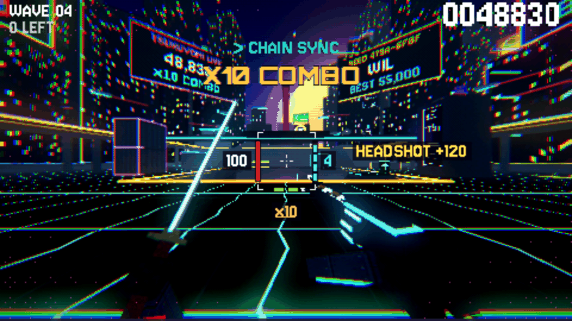

# How to Play

## The loop

**Blast, stagger, slash, glory kill, recharge.**

1. **Blast** with the [arc shotgun](Weapons#raijin-12-arc-shotgun) (right
   mouse). It knocks enemies back and wears down their **poise**.
2. When poise runs out the enemy is **STAGGERED**: a pulsing marker sits
   over it and its eyes dim. It stays that way for 1.8 to 3.2 seconds
   depending on the enemy.
3. **Slash** with the [katana](Weapons#dojigiri-katana) (left mouse), or
4. press **F** for a [glory kill](Glory-Kills): a finisher that heals you
   and gives you 3 cells.
5. **Recharge**: every katana kill charges one shotgun cell, so the blade
   keeps the gun fed.

The blade charges the gun; the gun sets up the blade. Keep both hands busy.

## Reading the screen

Your vitals sit in a **square frame round the crosshair**, so you never look
away from the fight. The middle of the frame is open, so it never hides the
enemy you are aiming at.

- **Left edge, red: health.** The number beside it turns red below 30%.
- **Right edge, cyan: shotgun cells**, one block per cell. The number turns
  red when you have none.
- **Bottom edge, green: dash charges.**
- **Under the frame:** your combo (`x12`, with its timer as a line under
  it) and, when you can finish an enemy, the **F GLORY KILL** prompt.
- **Right of the frame:** kill tags (HEADSHOT, RETURN TO SENDER...), three
  at most, newest on top.
- **Top left:** the wave and how many enemies are left. **Top right:** your
  score. **Top centre:** a boss's name, health and KAMAE bar.
- **Orange arrows at the screen's edge:** once a wave is down to its last
  three enemies, each one you can't see gets an arrow pointing to it (an
  arrow on the bottom edge means behind you), and far-off ones on screen get
  a small chevron over their heads. On a boss wave, a bigger arrow points to
  the boss whenever it's off screen, and once it falls its last few helpers
  get arrows too.
- **Big moments** (X10 COMBO, GLORY KILL with its points, KAMAE BROKEN, a
  boss enraging) appear just under the top row. **Warnings** (MISSILES
  INBOUND) take over the bottom of the screen as a red emergency band;
  **hints** (tips, in yellow) appear at the bottom centre.
- **Bottom left:** the wave's mutator. **Bottom edge:** a thin purple line
  that fills toward your next level-up.

Every kind of message has its own place, and a new one replaces the old, so
text never piles up.

## Your health

- You have **100 HP** (the Kongo Heart card adds 25 per rank).
- **Health orbs** drop from kills and fly to you, each healing 6 HP. Grunts
  drop one 30% of the time, gunners 50%, brutes always drop 4, and every
  glory kill adds 4 more.
- Glory kills heal 20 HP on the spot.
- A dash makes you untouchable for a moment; use it to get through attacks.
- Below 30% health the health bar pulses, the number turns red and a quiet
  heartbeat plays.
- Falling off the map puts you back at the start point.

## Shotgun cells

The shotgun's ammo is **cells**. You start with **4** (6 with the Inazuma
Overload card) and each blast spends one.

| You get cells from | How many |
| --- | --- |
| A katana kill | +1 (more with the Blood Battery card) |
| Deflecting a shot | +1 (+2 for a [perfect deflect](Weapons#perfect-deflect)) |
| A glory kill | +3 |
| Clearing a wave | +2 |
| Waiting, while you have fewer than 2 | +1 every 2.5 s |

Out of cells, the shotgun fizzles and the screen says **NO CHARGE - USE THE
BLADE**.

## Staggering

Every enemy has hidden **poise**. Damage wears it down, and at zero the enemy
staggers. The shotgun is your main staggering tool; armoured brutes barely notice
the katana until you blast them. Poise comes back
if you leave an enemy alone for about 2 seconds.

Bosses are different: they never stagger. You break them by filling their
**KAMAE** bar instead, then press F for the **ONIKIRI** blow
([Bosses](Bosses#kamae-and-the-onikiri)).

A staggered enemy takes full katana damage through its armour, so a slash can
just kill it. A glory kill gives you more (health, cells, double points).

## Waves and bosses

Waves never end and get harder as you go. Every third wave is a
[boss](Bosses). Between waves a [score tally](Scoring-and-High-Scores) pays
out, and from wave 2 a wave can roll a [mutator](Waves-and-Mutators) that
makes it harder for more points.

## Leveling up during a run

Kills give **run XP** (grunt 10, gunner 18, brute 60, bosses 320 to 500). Each
**RUN LV** pauses the game and deals three
[level-up cards](Level-Up-Cards). Pick one. Cards that belong to the same
[build](Builds) work together. Your run level resets every run; your
**PLAYER LV** never does ([Player Level and Rewards](Player-Level-and-Rewards)).

The next run level needs 60 XP, then 40 more for each level after (100, 140,
180, ...).

## Tips

- Shotgun first, katana second. A blast staggers a crowd; the blade cleans up
  and pays you back in cells.
- Gunners' shots can be slashed back at them for huge damage. Watch for the
  glowing bolts.
- Brutes are armoured: blast them to stagger, then glory kill.
- Don't hoard dashes. Two charges come back fast.
- Waves 1 to 3 are a warm-up. Use them to try your new cards.
