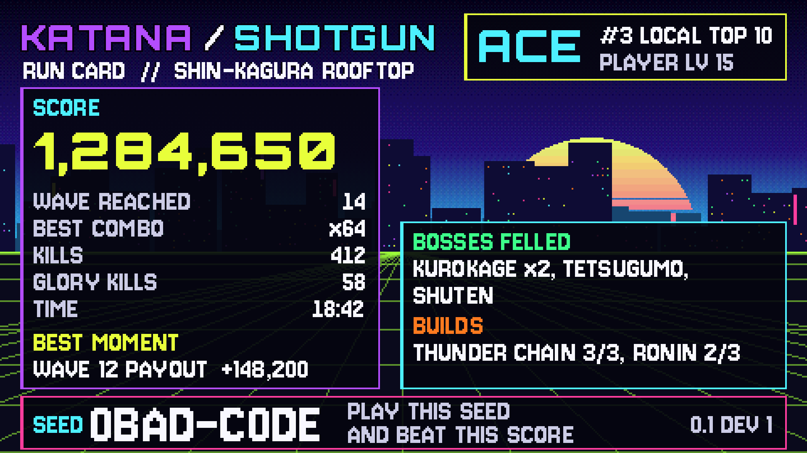

# Run Cards

A run card is a picture of your run, made to share. Post it on Discord or
send it by text, and your friend has your score and your [seed](Seeds) in
one image. The game stays fully offline; you send the picture yourself.

## Saving one

1. When a run ends, wait for the results screen to finish counting up (and
   type your initials if you made the high-score table).
2. Press **P** (for picture), or click **RUN CARD** in the row along the
   bottom.
3. The top right corner says **RUN CARD SAVED**. Press **O**, or click
   **OPEN FOLDER** (where RUN CARD was), to open the folder with your card
   picked out, ready to drag into a chat.

Each run can save one card. Cards are never overwritten: a second card with
the same name gets `_2` added.

## Where cards go

On Windows, cards go in your **Pictures** folder, in a folder called
**KatanaShotgun**:

`C:\Users\<your name>\Pictures\KatanaShotgun\`

The file is named after the seed, wave and score, like
`runcard_0BAD-C0DE_wave14_1284650.png`. If your PC has no Pictures folder,
the card goes in the game's save folder instead
(`%APPDATA%\KatanaShotgun\run_cards\`).

## What's on the card

- Your **score**, the **wave** you reached, best combo, kills, glory kills
  and time
- The **bosses** you felled and the [builds](Builds) you linked or
  completed
- Your **best moment**: your biggest end-of-wave payout
- Your initials and place, if the run made the local top 10, and your
  [Player Level](Player-Level-and-Rewards)
- The **seed**, big and clear at the bottom, so a friend can play the same
  run and try to beat you

The card is drawn in the run's own colour palette, so every seed's card
looks a little different. It's 1920x1080 with big, sharp pixels, like the
game.

Run cards are an idea on trial: they stay if they feel right in play.
