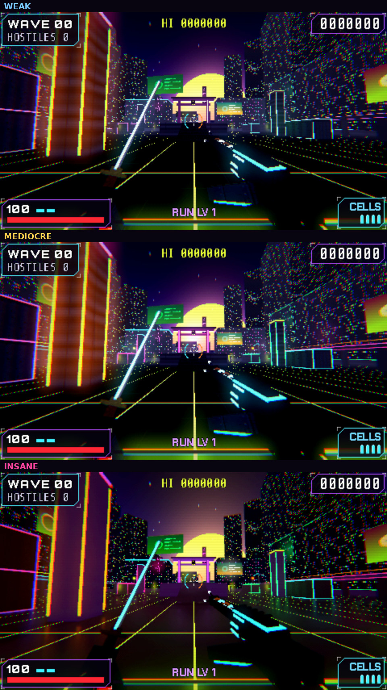
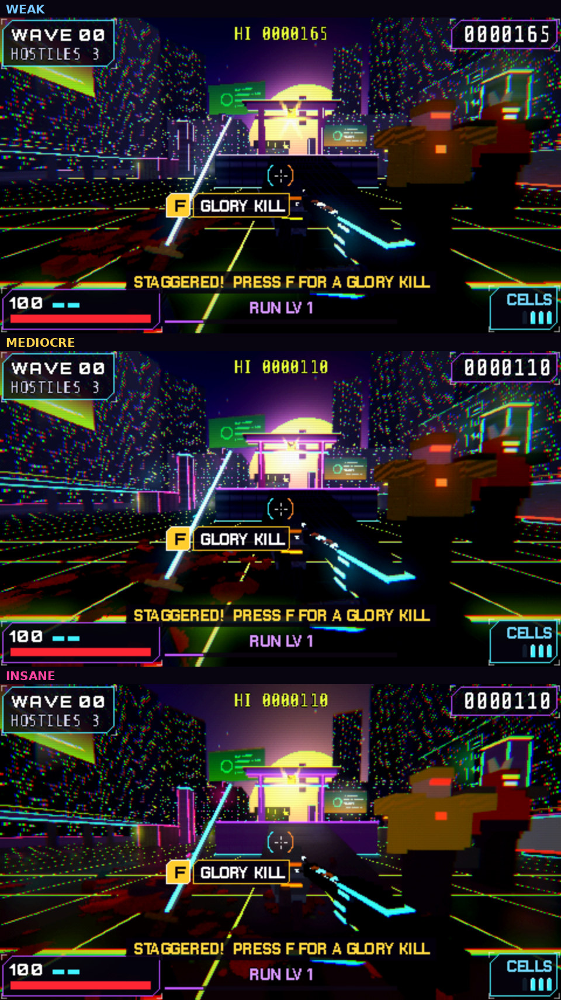

# Settings

Open **Settings** with **Tab** or the **SETTINGS** button on the title or
pause screen. Everything works with the mouse: click a tab, click the left or
right half of an option to change it, and drag or scroll a slider. Changes
apply at once and are remembered next time. **DEFAULTS** resets the tab you're
on; **BACK** (or Esc) closes the screen.

## Audio

Volume sliders for each part of the mix: **Master**, **Music**, **Sound
effects**, **Ambience** (rain and the city) and **Menus/HUD**.

## Video

| Setting | Choices | Default |
| --- | --- | --- |
| Window mode | Windowed, Full screen, Exclusive full screen | Full screen at your screen's resolution |
| VSync | On (no tearing) or Off (less input lag) | Off |
| Frame cap | Unlimited, or 60, 75, 120, 144, 165, 240, 360 fps | Unlimited |
| Graphics | WEAK, MEDIOCRE, INSANE (see [Graphics presets](#graphics-presets)) | MEDIOCRE |
| Render scale | 50% to 100% of the 3D view's sharpness. Lower runs faster | 100% (WEAK uses 75%) |
| Field of view | 70 to 110 | 88 |

The game keeps its chunky PS1/PS2 pixel look at any resolution: the 3D view
is drawn at 960 × 540 and scaled up in whole steps without smoothing, so on a
4K screen every game pixel is a sharp 4 × 4 block, and 2 × 2 on 1080p. The
Video tab names the screen it detected. **F11** switches between full screen
and a window.

**If the game runs slowly:** set Graphics to WEAK first, then lower the
Render scale. Press **F3** in a game to see your frame rate.

### Graphics presets

Every preset keeps the same chunky PS1/PS2 look. The higher ones add light,
not realism.

| | WEAK | MEDIOCRE | INSANE |
| --- | --- | --- | --- |
| For | Old laptops and integrated graphics | Most PCs | A strong graphics card |
| Light | The plain look | The plain look | Light that bounces (neon colours the floor), soft shadows from the moon, shading in every corner |
| Glow and air | The plain glow | Wider neon glow, a soft haze around every lamp | Real fog that the lamps light up |
| Floors | Dry | Dry | Wet: they reflect the neon |
| Blood and chunks | Fewer | More | Even more per kill |
| Flying cars in the city | Fewer | More | The most |
| Edges | Jagged | Smoother | Smoothest |

**INSANE restarts the game.** It runs on a different part of Godot (the
Forward+ renderer, using Vulkan or Direct3D 12). When you pick INSANE, or
leave it, the **QUIT GAME** button at the bottom left of Settings turns into
**RESTART GAME**: click it twice and the game closes and opens again with the
new look. If you don't restart, the change happens the next time you start
the game. If your graphics card can't run INSANE's renderer, the game starts
on the basic one by itself and Settings tells you so.

## Controls

- **Mouse sensitivity** (the `[` and `]` keys change it in game too).
- **Key bindings:** two keys or mouse buttons for each of Katana, Shotgun,
  Glory kill (F), Jump, Dash and the four move directions.
  - Click a slot, then press the new key (or click the slot with the mouse
    button you want).
  - Right-click a slot to clear it.
  - Taking a key another action uses swaps the two.
  - Esc and F11 can't be rebound.

## Comfort

- **Screen shake:** how much the camera and HUD shake.
- **Flashes:** how strong the screen flashes are. Below 100%, impact frames
  stop strobing.

## Quit game

**QUIT GAME** on the title, pause and Settings screens closes the game after
saving. Click it twice: the first click only asks you to confirm, so a stray
click never quits.

Settings are saved inside your profile, so they share its backup
([Saving and Continuing](Saving-and-Continuing)).
